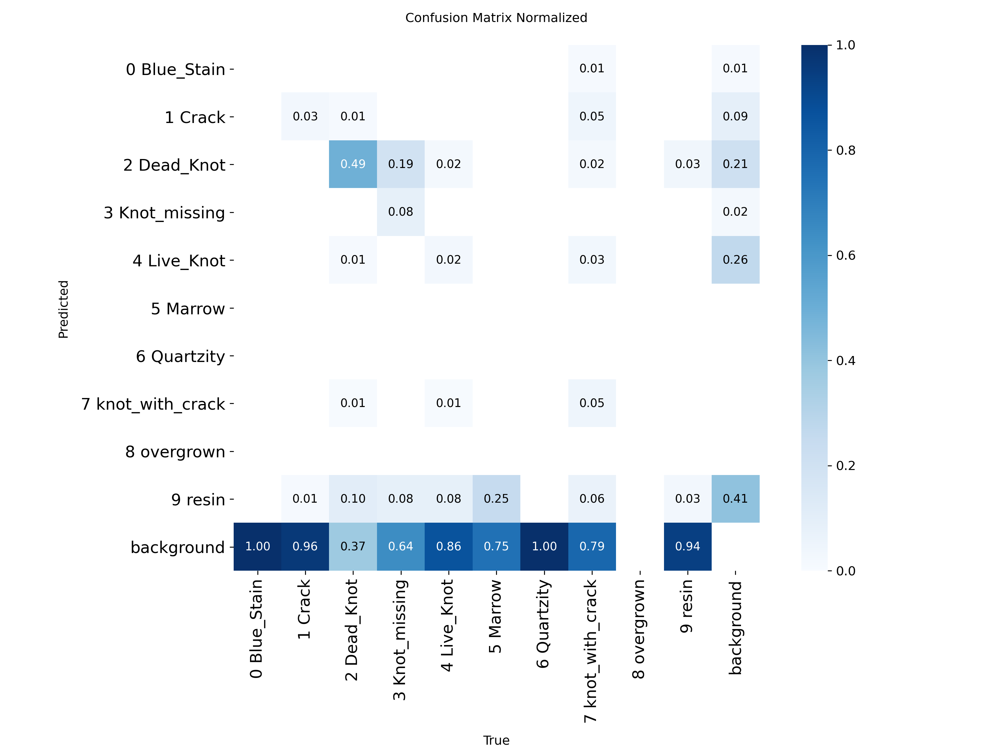
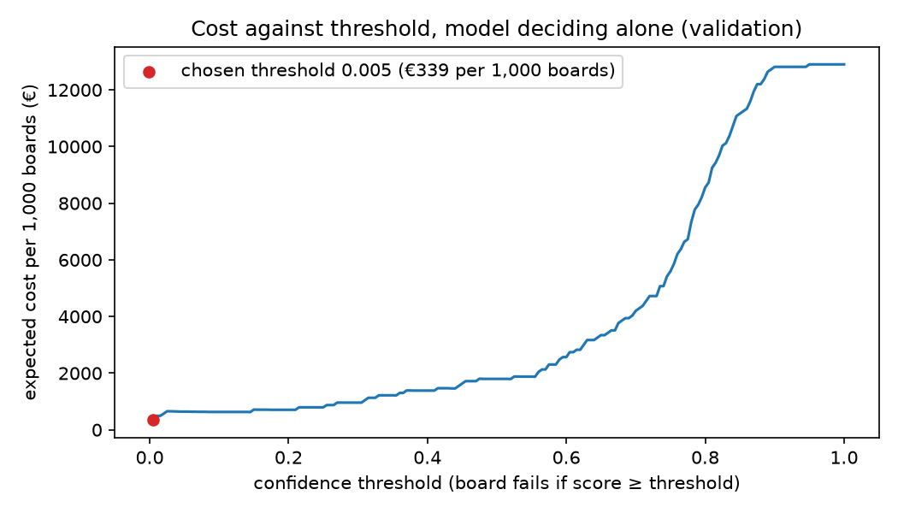
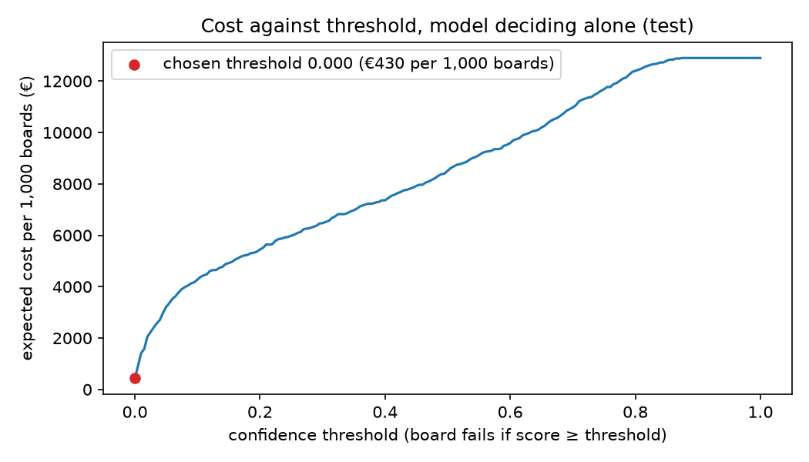

# Assignment 2 Report

- **Name**: Tomás Roschge
- **Student ID**: 19045
- **Email**: troschge.ieu2022@student.ie.edu
- **Group**: BBADBA 5A

## Business problem, and the cost of being wrong

At a mid-sized spruce sawmill in Central Europe, every board is inspected at the end of the planing line. Two human graders on each shift look at each board and decide on its grade. The board can move on to the premium grade, which is then sold to furniture and panelling manufacturers who need clean visible surfaces, or to the standard grade, sold at a lower price for construction, packaging and pallets, as appearance does not matter. The model supports this decision: from a camera image of the board, it flags whether the board has a defect that disqualifies it from the premium grade. Clear cases are sorted automatically and borderline cases are sent to a grader.

### What counts as positive
I treat a board section as **positive (fails premium grade)** if it contains at least one attribute that would make the furniture customer reject the board. This can be by because:
1. It weakens the board or can fall out; cracks, dead or missing knots.
2. It ruins the finish: resin pockets, which bleed through paint
3. It discolours or ruins the visible surface of the board.

A board is **negative (acceptable for premium)** if it has no defect, or only sound, intergrown knots or minor irregularities. These are part of the natural look of spruce, and visual grading rules allow them within limits.

I define "positive" as "has a disqualifying defect" because that is the event the model must detect and classify.

### Three outcomes

The model gives each board section a score: the highest confidence among all disqualifying defects it detects in the image. Two thresholds split that score into three outcomes:

- **Pass** (score below the lower threshold): the board goes straight to the premium stack, without human inspection.
- **Review** (score between the two thresholds): diverts the board to a side conveyor, where a grader inspects the physical board, and decides the grade. I assume about **10 seconds** per board, compared with the **2–3 seconds** a grader has today to judge a board at full line speed. We take it off the main line so the review does not slow the line down.
- **Fail** (score above the upper threshold): the board goes straight to the standard-grade stack, without human inspection.

Today, the graders judge every board. With the model, only the boards in the review band are inspected, so the question becomes whether that band is small enough for them to keep up (see "What a person still has to check").

### The cost of being wrong

The costs are measured against a perfect grader: the cost of an outcome is the extra money that the company loses compared with sending every board to its correct grade. That is why a true positive (a defective board correctly downgraded) and a true
negative (a good board correctly sold as premium) both cost **€0**: each board is sold at the price it deserves.

**Board assumed**: planed spruce board, 25 × 150 mm × 4.0 m ≈ **0.015 m³**.

- **False positive** (a good board is downgraded to standard). The sawmill sells it at the standard price instead of the premium price.
  - Standard spruce price: about **€310/m³**. This is the 44–50 × 150 mm spruce price in Germany in December 2025 (€305–325/m³, Fastmarkets).
  - Premium visual-grade price: about **€372/m³**. I took the standard price and applied a +20% grade premium, which is the price ratio between "unsorted" (joinery quality) and "fifths" for the same 25 × 100 mm planed board at a UK timber merchant (£4.49 vs £3.74 per metre ex VAT). Retail prices are much higher than wholesale, so I use only the ratio, not the absolute price.
  - FP cost = (372 − 310) × 0.015 ≈ **€0.93 per board**.

- **False negative**:
  - Replacement premium board: 372 × 0.015 ≈ €5.60
  - Claim handling and admin: ~20 min of sales/quality staff × ~€25/h ≈ **€8**
  - Share of return freight and repackaging: €150 return shipment shared across ~30 boards in a typical claim ≈ **€5**
  - Goodwill discount and risk to the account: a 2–3% discount on a ~€200 package ≈ **€5**
  - FN cost ≈ **€24 per board**.

- **Human review**: **assumed** 10 seconds per board × €20/hour fully loaded
  labour cost ≈ **€0.06 per board reviewed**

A false negative is about **25 times** as costly as a false positive (€24 vs €0.93). The most uncertain figures are the visual-grade premium and the goodwill component of the FN. I will test how the threshold changes if the ratio is anywhere between 10× and 50×.

### Volume and base rate
Modern planer mills with automatic grading run 75–240 boards per minute, and at those speeds manual grading is close to impossible. A mill that still grades by hand runs slower, so I assume **40 boards per minute**, over two shifts of 7.5 productive hours: about **36,000 boards a day**, checked today by two graders on each shift.

Most boards do not reach the premium visual grade: it is the minority, high-value share of the output. Clear grades are only about 5% of spruce lumber in one study of Alaskan Sitka spruce. I expect a large share of boards to have at least one disqualifying defect. I fix the exact base rate in the cost section.

### What this means for the rest of the project
Because a missed defect costs about 25 times as much as a downgraded good board, I care more about **recall** on the disqualifying defects than about overall accuracy or mAP. This pushes the threshold lower: I would rather downgrade
or review a good board than let a defect through. The limit is people: with only two graders, it is not realistic that they will review a large portion of a line running at 40 boards per minute, so the review band has to stay small.

## Dataset

**Roboflow Universe**: workspace `defect-detection-w4mv8`, project
`wood-defect-detection-9w3x4`, **version 6**
(https://universe.roboflow.com/defect-detection-w4mv8/wood-defect-detection-9w3x4/dataset/6).
Object detection, CC BY 4.0. Used as published, not forked.

**Origin.** This Roboflow project is a 3,258-image subset of a public dataset of wood surface defects collected by VSB – Technical University of Ostrava (Czech Republic) on an active sawmill production line (Kodytek, Bodzas and Bilik, *F1000Research* 2022). The images were taken by an industrial line-scan colour camera with LED lighting while boards moved along the conveyor. The authors describe the material only as sawn timber and do not name the species. The images show a light-coloured softwood consistent with spruce, which is the assumption of my business case.

**What one image represents.** An image is a section of the surface of one board as it can be seen from above by a camera. Each defect is marked with a bounding box and one of 10 defect distinct classes. Images with no boxes are defect-free boards. For the analysis, I treat one image as one board. 

**Classes and how they map to my business case.**

| Dataset class | What it is | My label |
|---|---|---|
| Crack | crack in the wood | **positive** |
| Dead_Knot | dead, loose knot | **positive** |
| Knot_missing | hole left by a knot that fell out | **positive** |
| knot_with_crack | knot with cracks around it | **positive** |
| Marrow | pith (centre of the log) | **positive** |
| resin | resin pocket | **positive** |
| Blue_Stain | fungal blue discolouration | **positive** |
| Live_Knot | sound, intergrown knot | negative (acceptable) |
| Quartzity | grain irregularity | negative (acceptable) |
| overgrown | — | excluded (see next section) |

A board is **positive** if it contains at least one box that belongs to the positive class. The image's score is the highest confidence the model gives to any positive class detection. Live knots and Quartzity do not make a board fail. Never.

**Why this dataset serves the problem rather than merely resembling it.**
1. **Same view as production site.** The images come from a camera over a real sawmill conveyor, which is exactly where the model would be useful.
2. **The classes match the business decision.** The dataset separates and distinguishes between live knots from dead ones. It also labels cracks, resin, and blue stain separately. The business case I am proposing depends on these differences: a single defect could not tell an acceptable knot from a disqualifying one.
3. **Defect-free boards are labelled.** Clean boards appear as images with no boxes. These are the negatives needed to measure false positives (the cost of downgrading good boards).

## What the dataset's composition implies

**Split sizes.** Train has 1,733 images, test has 1,525 and **valid has 0**. Training needs a validation set, so I hold out 15% of train with a fixed random seed and leave test untouched.

**Instances per class.**

| Class | Train | Test | My label |
|---|---|---|---|
| Live_Knot | 2,108 | 288 | negative |
| Dead_Knot | 926 | 299 | positive |
| resin | 313 | 236 | positive |
| knot_with_crack | 130 | 108 | positive |
| Crack | 82 | 465 | positive |
| Marrow | 83 | 4 | positive |
| Quartzity | 81 | 34 | negative |
| Knot_missing | 48 | 73 | positive |
| Blue_Stain | 26 | 75 | positive |
| overgrown | 2 | 0 | excluded |

**Images by my business rule.**

| | Train | Test |
|---|---|---|
| Positive (at least one disqualifying defect) | 1,033 (59.6%) | 592 (38.8%) |
| Negative: only live knots / quartzity | 700 (40.4%) | 141 (9.2%) |
| Negative: no defect at all | **0 (0%)** | **792 (51.9%)** |

**Object size.** Defects are small: the median box covers about 0.3% of the image. YOLO resizes the longest side to 640 px, so a typical defect ends up about 21 × 21 px, and the smallest 10% of resin pockets and missing knots end up around 8–12 px.

**What this implies.**
1. **Test does not look like train.**
   - Every test image is rotated 90° (704 × 1,924, board vertical), while every train image is in the original camera orientation (2,800 × 1,024, board horizontal).
   - All 792 defect-free boards are in test, and train has none.
   - Test has 5.7 times more cracks than train (465 vs 82).
   A model trained on train is therefore evaluated on images that differ in orientation and in mix. A drop in the test performance may come from this (in the end it came from a different camera, see "Validation vs. Test"), not from the model's ability to see defects.
2. **Some per-class numbers are too thin to trust.**
   - **Overgrown** (2 examples, none in test) is excluded.
   - **Marrow** has only 4 test instances, so its precision and recall mean nothing.
   - **Blue_Stain** (26 train instances in 17 images) and **Knot_missing** (48) give the model very little to learn from.
   - **Crack** is the most worrying: it is a key disqualifying feature, but the model is tested on 465 examples while it only learns from 82
3. **Small objects favour a larger input size.** At 640 px the smallest defects are only a few pixels wide. This is an argument for training at 1,280 px.
4. **Test composition is not production composition.** On the real line, about 90% of board images have at least one defect (18,283 of 20,275 in the original data), whereas in test only 48% do. So it would not make sense to read the expected cost directly off test, which is why I measure error rates on validation and test and reweight them to the production base rate.
5. **What I cannot conclude.**
   - Nothing reliable about Marrow, Blue_Stain or Knot_missing on their own.
   - Results only hold for this camera and this lighting.
   - The headline decision ("does the board have any disqualifying defect?") uses all positive classes together, so it is much more stable and reliable than any single class.

## Finetuning and baselines

### Task and Model

I've decided to initially treat this as an object detection, not image classification. This is because the grading rule depends on which defect the board has, not just if it has a defect. And that distinction is very important; as highlighted above, some defects will make the board go to the standard grade, while others will not make the downgrade and send it to premium grade. For example; a live knot is acceptable in the premium grade, but a dead knot is not. A pure classifier trained on "acceptable/not acceptable" would have to learn that rule implicitly, while the detector learns each class separately. This allows for correct identification of defects, and to later apply the business rule on top of this output. The boxes show the grader where to look when a board is sent to review.

Finetuned yolo11s rather than yolo11n. Defects are small (the median box covers about 0.3% of the image), so I train at 1,280 px, and the larger model has more capacity to pick up fine detail at that resolution. The training was ran on a T4 GPU using Google Colab. This is because the extra cost of the "s" model is affordable, and, as in production, inference is per board and on one camera image, the "s" model is still fast enough for the line. 

### Training setup

I started from yolo11s.pt, pretrained on COCO, and finetuned it on the wood dataset (transfer learning: the network already knows generic edges, textures and shapes, so it only has to learn what wood defects look like). The dataset on its original form has no validation split, so I separated 15% of the training images with a fixed seed (42) for validation. Test images originally came in portrait orientation, so I rotated them 90° to landscape, the training orientation, before evaluation. The dashboard applies the same rotation to the uploaded images.

| Setting | Value | Why |
|---|---|---|
| Base model | `yolo11s.pt` (COCO pretrained) | transfer learning: generic features already learned |
| Input size | 1,280 px | defects are small (median box ≈ 0.3% of the image) |
| Epochs | up to 100, early-stopping patience 20 | stop if validation stops improving |
| Batch size | 8 | largest that fits a T4 GPU at 1,280 px |
| Augmentation | Ultralytics defaults + vertical and horizontal flips (p = 0.5) | a defect is the same defect in any orientation |
| Validation | 15% of train, held out with seed 42 | the dataset has no validation split; test stays untouched |
| Seed | 42, deterministic | reproducible split and training |
| Hardware / time | Colab T4 GPU, ≈ 2.6 h | |
| Best epoch | 95 of 100 (validation mAP50 0.717) | early stopping never triggered |

Training was done on 100 epochs on Google Colab T4, with an early stopping of 20 consecutive epochs without improvement. This early stopping didn't triggered, and the training lasted for about 2.6 hours. The best validation mAP50 (0.717) was reached at epoch 95 of 100, and the weights from that epoch are the ones committed in `weights/`. A longer run might have added a little more, as the curves were still slightly rising at the end. 

### Results against the baselines

All three models are evaluated on the same test split (1,525 images). I report two levels:

- Boxes (mAP50): does the model find each defect, in the right place and with the right class?
- Boards (ROC AUC, recall, precision): does the board score (the highest confidence among disqualifying defects) separate boards with defects from perfectly good ones? This is the level the business decision is made on.

Recall, precision and FPR (False Positive Rate) for boards are measured at a confidence of 0.25. The threshold I actually use is chosen later, by cost.

The two baselines:

- COCO zero-shot: the pretrained yolo11s.pt with no finetuning. COCO has no wood-defect classes, so its mAP50 is 0 by construction. As a board score I use its highest confidence on any detection, as if the model detecting something meant “defect”.
- Trivial, predict nothing: every board scores 0 and is passed as premium. This is what the mill gets if the model was not implemented.

| Model | mAP50 (boxes) | ROC AUC (boards) | Recall | Precision | False positive rate |
|---|---|---|---|---|---|
| yolo11s finetuned | 0.068 | 0.770 | 0.54 | 0.73 | 0.13 |
| COCO zero-shot | 0.000 | 0.598 | 0.06 | 0.49 | 0.04 |
| Trivial: predict nothing | 0.000 | 0.500 | 0.00 | – | 0.00 |

The finetuned model beats both baselines on every important metric. AUC of 0.77 means that if I choose one defective and one good board at random, the defective one gets the higher score 77% of times, against 60% for COCO and 50% (a coin flip) for the trivial baseline. COCO’s low FPR (False Positive Rate) is not a strength: it flags almost nothing, so it also misses 94% of defective boards.

### Validation vs. Test

The finetuned model beats both baselines on test, but by much less than its validation scores suggested.

| Same model, evaluated on | Images | mAP50 | mAP50-95 | ROC AUC (boards) | Recall | Precision | False positive rate |
|---|---|---|---|---|---|---|---|
| Validation (15% of train, same camera) | 260 | 0.715 | 0.452 | 0.935 | 0.95 | 0.85 | 0.22 |
| Test (different source) | 1,525 | 0.068 | 0.027 | 0.770 | 0.54 | 0.73 | 0.13 |

Due to the different mix of classes between test and validation, I expected test to be harder, but not a tenfold drop in mAP50. In order to find the cause of this drop, I first ruled out a bug in the rotation: I drew the original test labels on the rotated images, and the boxes sit on the defects. As I looked at the actual images, I realized that the test set comes from a different camera (source); the boards are narrower, the wood has a greener tint, and the lighting seems different. As the model had already learned how the defects looked like under the training set camera, and that knowledge only partly transfers into the test set, I concluded this was not a training failure but a domain shift. 

There are two things in the table worth explaining:

- Board-level AUC drops much less than box-level mAP50 (0.94 to 0.77 vs 0.72 to 0.07). For the model to flag a board, there only needs to be one disqualifying defect that gets a high score. A box that is misplaced, or a crack labelled as resin, will still send the board to the right place, although the mAP is ruined. So the business decision is more robust than the box metric
- The FPR is higher on validation (0.22 vs 0.13). This represents the difference between the two sets, not an improvement in test. Negatives on the validation set are boards with live knots and Quartzity, which look like defects. Negatives on the test set are mostly clean boards (792 out of 933), which are easy to call clean.

From now on, I decided to run the cost analysis on both splits, for the following reason: If the mill's camera matches the training camera, validation will be the best estimate, with two caveats; it is small (only 260 images), and slightly optimistic as it was also used to choose the best epoch. If the camera is different, then the test set will show what happens. Therefore, which number to believe depends on the line. 

## Per-class evaluation and failure modes

### Positive class and per class table

**Positive class**. A board is positive if it has at least one disqualifying defect (Blue_Stain, Crack, Dead_Knot, Knot_missing, Marrow, knot_with_crack or resin), and it then goes to the standard grade. Live_Knot and Quartzity can be detected but never make a board fail. The table below is at the box level: each defect class separately, as the model sees them.

| Class | Role | Val instances | Val P | Val R | Val mAP50 | Test instances | Test P | Test R | Test mAP50 |
|---|---|---|---|---|---|---|---|---|---|
| Dead_Knot | positive | 123 | 0.78 | 0.73 | 0.82 | 299 | 0.42 | 0.51 | **0.45** |
| resin | positive | 46 | 0.82 | 0.70 | 0.82 | 236 | 0.02 | 0.03 | 0.00 |
| Crack | positive | 15 | 0.48 | 0.67 | 0.68 | 465 | 0.14 | 0.03 | 0.02 |
| knot_with_crack | positive | 21 | 0.77 | 0.95 | 0.94 | 108 | 0.35 | 0.05 | 0.05 |
| Knot_missing | positive | 3 | 0.84 | 1.00 | 0.99 | 73 | 0.30 | 0.11 | 0.08 |
| Blue_Stain | positive | 9 | 1.00 | 0.32 | 0.45 | 75 | 0.00 | 0.00 | 0.00 |
| Marrow | positive | 21 | 0.96 | 0.76 | 0.90 | 4 | 1.00 | 0.00 | 0.00 |
| Live_Knot | acceptable | 316 | 0.89 | 0.80 | 0.89 | 288 | 0.03 | 0.03 | 0.01 |
| Quartzity | acceptable | 10 | 0.87 | 0.50 | 0.66 | 34 | 0.00 | 0.00 | 0.00 |
| overgrown | excluded | 1 | 0.00 | 0.00 | 0.00 | 0 | – | – | – |
| **All classes** | | | | | **0.715** | | | | **0.068** |

### Which class carries the headline number?

On test, Dead_Knot scores 0.45, so almost all of the overall mAP50 comes from it. Every other class is below 0.10. The test mAP50 of 0.068 is the average over 9 classes, and Dead_Knot alone comprises about three quarters of it (0.45 of the 0.62 total). Taking out Dead_Knot, the test average would be at around 0.02.

**Why does Dead_Knot survive the change of camera?:**
- It is the most frequent disqualifying defect in training (926 instances, 3x more than the resin, the next one). 
- It is a large object
- It is defined by shape and contrast (a dark, round knot) more than by exact color, so the different aspects of the other camera do not hide it. 

On test boards, this is also the most common disqualifying defect (255 of the 592 positive images), so much of the board-level AUC of 0.77 rests on detecting dead knots.

On validation, the playfield is more even; every class with more than a handful of examples is between 0.66 and 0.94. Live_Knot, the class with the most data (316 instances, AP50 of 0.89), is acceptable, so it does not decide any board by itself.

### Where it fails

1. **Thin defects: Crack.** The most serious failure. It is the most frequent disqualifying defect on test (465), and the model finds almost none: 448 are missed (recall 0.03). Cracks are only a few pixels wide but long, and the model learned them from just 82 training examples. On validation, Crack is also the weakest positive class with enough data (precision 0.48).
2. **Colour-defined defects: Blue_Stain and resin.** Blue stain is a discolouration of the board, and resin is like a yellow streak on it. As both of them are recognized mainly by color (which is one of the weak points of switching up the camera for test), Blue_Stain is never found on test (0 of 75) (it is worth mentioning it was already weak on validation with recall of 0.32 on 9 instances). Resin drops from 0.82 on validation to 0.00 on test: it misses 222 of 236, and it also invents resin where there is none (precision 0.02, see the confusion matrix below).
3. **Rare classes: Knot_missing, knot_with_crack, Marrow, Quartzity.** Too few examples to learn well or to judge. Knot_missing (3 validation instances) and Marrow (4 test instances) cannot be read either way.
4. **The acceptable class: Live_Knot.** It decreases from 0.89 on validation to 0.01 on test. Missing a live knot costs nothing, since it never made a board fail. The problem arises when a Live_Knot is mistaken for a disqualifying defect (24 times as resin, 5 as Dead_Knot), as that downgrades a good board. 

Putting it on business terms, a missed defect only becomes a FN if the model finds no other disqualifying defect on that board. A false defect box turns a good board into a false positive. The first one is the most expensive error, which is why the Crack failure matters most. 

### What it confuses with what

The confusion matrix on test (columns are the true class, rows are the prediction, normalised per true class, at a confidence of 0.25) shows that the main problem is telling defects apart from plain wood, not mixing up defect classes:

- **Missed defects (bottom row, predicted "background"):** Most true defects get no box at all. 100% of Quartzity and Blue_Stain, 96% of Crack, 94% of resin, and 86% of Live_Knot. Dead_Knot is the exception at 37%.
- **Invented defects (right column, true "background"):** When the model draws a box on clean wood, it is resin 41% of the time, then Live_Knot (26%), Dead_Knot (21%) and Crack (9%). In absolute terms, that means 245 false resin boxes against 14 resins found. This means that on the test set camera, the model interprets the greener wood as resin. 
-  **Confusions between classes:** Fewer, and most do not change the boards outcome.
  - **Harmless (positive ↔ positive):** Knot_missing called Dead_Knot (19%), Dead_Knot called resin (10%), Marrow called resin. Either way, the board fails correctly.
  - **Costly (acceptable → positive):** Live_Knot called resin (8%) or Dead_Knot (2%). These downgrade a good board, which is a FP.
  - **Dangerous (positive → acceptable):** Dead_Knot or knot_with_crack called Live_Knot (1–3%). These can pass a defective board as premium, which is a FN. They are rare.

This means that for the business decision, the class confusions matter less than the two background errors. Missed cracks produce FNs, and resin invented on clean wood produces FPs. Both get worse when the camera is changed (test set)

## Cost matrix and operating point

### Cost matrix

The figures were fixed before any model was trained, and are derived in the business section. Each cost is the extra money lost compared with a perfect grader, so a correct decision costs 0€. 

| True board \ Decision | PREMIUM (pass) | REVIEW (grader) | STANDARD (fail) |
|---|---|---|---|
| Defective | **FN: €24.00** (claim, replacement, freight, goodwill) | €0.056 (10 s of a grader at €20/h) | TP: €0 |
| Good | TN: €0 | €0.056 | **FP: €0.93** (premium price lost) |

I assume the grader decides correctly, so a reviewed board only costs the review time.

**Base Rate:** The % of boards on the production line that fail premium is:
P(disqualifying defect) = P(any defect) × P(disqualifying | any defect) = 0.902 × 0.596 = 0.538

- 0.902 comes from the original paper: 18,283 of the 20,275 board images had at least one defect.
- 0.596 comes from the train and validation labels: of the images with at least one defect, 59.6% have at least one disqualifying one. I do not use test for this, because it comes from a different source (different camera as discussed before).

The production mix is not present in any evaluation split: validation is 57% positive, while test is 39%. This is why I measure the model's error rates within each class on an evaluation split, and weight them by the production base rate: 

cost per board = 0.538 × (FN rate × €24 + review rate among defective boards × €0.056) + 0.462 × (FP rate × €0.93 + review rate among good boards × €0.056)

### The sweep

I sweep one threshold from 0 to 1 in steps of 0.005: a board fails if its score is equal to or above it. The two ends are the “do nothing” options: threshold 0 fails every board (€430 per 1,000), and threshold 1 passes every board (€12,900).
- **Validation:** Minimum is at 0.005, 339€ per 1000 boards (-21% compared to all standard). The model only passes boards when it doesn't detect any disqualifying defect. 
- **Test:** Minimum is at 0. The model can't beat failing every board. 

The optimum is at the bottom of the scale because passing a board only pays if P(defective) < 0.93 / (0.93 + 24) ≈ 3.7%. Only the boards with no detection at all on validation are below that (≈ 2.5%); on test, those are ≈ 20%.

### Operating point (two thresholds)

With review, a board is PREMIUM if its score is below *lo*, REVIEW between *lo* and *hi*, and STANDARD at or above *hi*. I search every pair in the grid. Two graders can check at most 12 boards (2x6) per minute out of 40, so the band may hold at most 30% of boards.

| Split | lo | hi | Cost per 1,000 | Sent to review | Without the 30% limit |
|---|---|---|---|---|---|
| Validation | 0 | 0.005 | **€181** | 29% | €50 at hi = 0.70, but 62% review (5 graders) |
| Test | 0 | 0.02 | **€259** | 28% | €54 at hi = 0.785, but 97% review (7 graders) |

I chose lo = 0 and hi = 0.005 (for validation, which is same camera as training). With lo = 0, the model will never pass a board by itself, as every premium board will be confirmed by a person. The model's objective is triage; it sends the boards where it sees nothing to the grader, and fails the rest. For 1000 boards in validation this gives 292 boards reviewed, 0 FNs and 178 FPs (good boards failed). 

### Sensitivity and the assumption that matters most

I re-ran the search with FN/FP ratio at 10x, 25x and 50x, and the base rate at 40%, 53.8% and 80% (validation, 2 graders). Each cell shows (lo, hi) and the cost per 1,000 boards:

| FN/FP ratio \ base rate | 0.40 | 0.538 | 0.80 |
|---|---|---|---|
| 10× | (0.005, 0.655) €101 | (0.005, 0.665) €107 | (0, 0.555) €35 |
| 25× | (0.005, 0.655) €177 | **(0, 0.005) €181** | (0, 0.555) €35 |
| 50× | (0.005, 0.655) €302 | (0, 0.005) €181 | (0, 0.555) €35 |

The thresholds vary within two approaches:

- **A (chosen one):** Boards with no detection go directly to review, and everything else fails. The model doesn't decide anything on its own.
- **B:** Boards without detection from the model pass automatically, the uncertain middle (up to 0.66) goes to review, and only the high scores fail.

The assumption that would change the answer the most is the FN cost. The design switches from approaches A to B if a FN costs less than about 20€ (21x more than FP) instead of 24€, or if the base rate would be below 53% instead of 53.8%. The operating point sits close to that edge, as at the edge both designs cost the same (~181€), so the expected cost is robust even if the thresholds are not. 

On test, lo stays at 0 in every scenario. The camera is the assumption that moves the cost most: €181 on validation vs €259 on test.

## What a person still has to check

### Review load and staffing

At the chosen thresholds (lo = 0, hi = 0.005), 29% of boards go to a grader, which is about 10,500 boards per day, or 11.7 per minute. At 10 seconds per board, that means 1.95 graders will be busy, which is good as the mill has 2 on each shift. Their checking is narrow: the boards that the model found no disqualifying defect, to confirm they really are premium. On the test set, it is similar: 28%, about 9,900 a day at hi = 0.02.

The most important question: **Is it realistic?** Just. The two graders would be busy 97% of their time, with no minimum slack for distractions, inconveniences, or breaks. The 10 seconds per board is an assumption I have not measured. At 15 seconds, 2 graders would cover only 20% of the line, so the band would have no option than to shrink and the cost would rise. The other assumption is that the grader is always right, which is not very realistic: at almost 6 boards a minute for 7.5 hours, fatigue will make that false in practice.

### Priced against the alternatives

Validation, per 1,000 production boards and per day of 36,000 boards

| Option | Cost per 1,000 | Cost per day | Sent to review | Graders needed |
|---|---|---|---|---|
| Do nothing: sell every board as premium | €12,900 | €464,400 | 0% | 0 |
| Do nothing: sell every board as standard | €430 | €15,500 | 0% | 0 |
| A person checks every board | €56 | €2,000 | 100% | 7 |
| Model decides alone (t = 0.005) | €339 | €12,200 | 0% | 0 |
| **Model + review band, 2 graders (chosen)** | **€181** | **€6,500** | 29% | 2 |
| Model + review band, 5 graders | €50 | €1,800 | 62% | 5 |

Counting on the two graders the mill has, model + review is the cheapest feasible option: 58% below selling everything as standard, and 47% below the model deciding alone. On test, the same design costs €259 against €430 for the model alone, which is no better than all standard.

The table also shows something less comfortable: a person checking every board is cheaper than my chosen design (€56 vs €181). A 10-second look costs €0.056, and a wrongly downgraded board costs €0.93, so more review will always pay. The binding constraint is people and the realistic setting, not money. If the mill can hire, the best option is model + review with 5 graders (€50): cheaper than checking everything, with 2 fewer people, because the model fails the clearly defective boards without anyone looking at them.

## Limitations & next steps

| Limitation | Effect on my results | How I would address it |
|---|---|---|
| **Different camera on test** | Test mAP50 0.07 vs 0.72 on validation; on test the model alone cannot beat the "all standard" approach | Label a few hundred boards from the mill's own camera, finetune on them, and validate on a different set from that camera before shipping. Add colour augmentation to reduce the dependence on tint and the potential confusion (as seen on the model) |
| **No defect-free boards in training** | The model never saw a clean board; its "nothing found" score is what the review band is built on | Add the ≈ 2,000 defect-free images of the original dataset (20,275 − 18,283) to training |
| **Thin and rare classes** (Crack 82, Knot_missing 48, Blue_Stain 26 training instances) | Cracks, the most common disqualifying defect on test, are almost never found | Label more examples from the original dataset; train on image tiles so thin cracks keep more pixels and can be correctly identified |
| **Small validation set, used twice** (260 images, for choosing the epoch and the thresholds) | The validation cost (€181) is slightly optimistic and has no error bar | Hold out a separate set for thresholds; bootstrap the cost to get a realistic confidence interval |
| **Unmeasured cost and review assumptions** (FN €24, 10 s per review, grader always right) | The operating point flips if FN < €20; capacity drops to 20% at 15 s per review (which is still very realistic and there is no solid base to state it at 10s) | Time a grader on 100 boards and measure their error rate; get real claim costs from the sales team |
| **Base rate not measured on the line** (0.902 × 0.596, from the paper and labels) | The operating point flips if the base rate is below ≈ 53% | Count disqualifying boards over one week of production |

## Generative AI use disclosure

I used Claude Code Opus 5.5 throughout the assignment for:
- **Aligning chosen dataset with assignment guidelines** and ensuring I would not have to change it mid-assignment. It searched Roboflow Universe and screened candidates, whilst I chose the problem and the final dataset.
- **Code:** it wrote `train.py`, `wood_grading.py`, `app.py` and the Colab launcher, explaining each block before I accepted it. I trained the model on Colab myself.
- **Business framing on actual costs:** Researched price references and proposed grounds for assumptions
- **Investigation:** it guided me through the test drop investigation. I decided how to handle it and chose the operating point
- **Report:** Helped me structure each section and highlighted the core ideas I should include in each one. It was kind of "at the end, do the following checklist to make sure you included these things: ... ". It also provided the structure to include the tables. 

